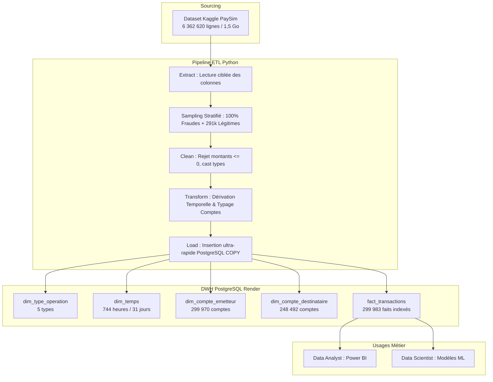

# 📘 Documentation Technique - Rôle : Data Engineer
**Projet Big Data : Mobile Money & Détection de Fraude (PaySim)**  
**Auteur / Rôle :** Data Engineer  
**Date :** Novembre 2026  
**Technologies :** Python 3.15, PostgreSQL 18 (Render Cloud), SQLAlchemy, psycopg2, pandas, Git  

---

## 1. Synthèse de la mission du Data Engineer

En tant que **Data Engineer**, ma responsabilité consistait à :
1. Concevoir l'architecture d'ingestion et de stockage sécurisée.
2. Développer un pipeline ETL Python reproductible, robuste et performant.
3. Déployer et alimenter l'entrepôt de données (DWH) sur PostgreSQL hébergé sur Render, modélisé en **schéma en étoile**.
4. Résoudre les contraintes techniques critiques :
   - Quota strict de **1 Go** de stockage sur Render Free Tier.
   - Durée de vie éphémère de la base (30 jours) exigeant une **reproductibilité en une seule commande**.
   - Préservation de la rareté de la fraude financière (~0,13% dans les données brutes) pour ne pas biaiser les futurs modèles de Machine Learning.

---

## 2. Architecture Technique Déployée



---

## 3. Détail des étapes de l'ETL

### A. Extraction (`etl/etl_pipeline.py`)
- Lecture par flux de `data/paysim.csv`.
- Sélection ciblée des attributs nécessaires : `step`, `type`, `amount`, `nameOrig`, `nameDest`, `isFraud`, `isFlaggedFraud`.

### B. Transformation & Nettoyage (Règles de Véracité)
1. **Échantillonnage stratifié intelligent** :
   - Le dataset brut totalise **6 362 620 lignes** pour seulement **8 213 fraudes** réelles.
   - Tout charger dépasserait le quota de 1 Go de Render.
   - **Règle appliquée** : Préservation intégrale de **100% des fraudes** + sous-échantillonnage stratifié par type de transaction sur les opérations légitimes.
   - Taille finale : **299 983 transactions**, représentant **2,73% de fraudes**.
2. **Nettoyage** :
   - Filtrage strict : `amount > 0` (suppression des montants nuls ou négatifs).
   - Gestion des valeurs manquantes (`fillna(0)`).
3. **Ingénierie des dimensions** :
   - **Temps** : Dérivation du `step` (1 heure) en jour du mois (1 à 31), heure (0 à 23), tranche horaire (*Nuit*, *Matin*, *Après-midi*, *Soir*) et indicateur de week-end.
   - **Comptes** : Catégorisation des comptes via leur préfixe (`C` = Client particulier, `M` = Commerçant / Merchant).
   - **Surrogate Keys** : Remplacement des identifiants textes par des clés numériques indexées.

### C. Chargement optimisé (Loading)
- Utilisation du protocole **PostgreSQL `COPY FROM STDIN`** (via buffer mémoire `io.StringIO`) au lieu de simples `INSERT` unitaires.
- Temps d'insertion de 300 000 lignes avec intégrité référentielle : **< 4 minutes**.
- Taille totale finale sur Render : **112 Mo** (soit seulement 11% de la limite maximale).

---

## 4. Modèle de Données (Schéma en Étoile)

```
        +-------------------------+
        |   dim_type_operation    |
        +-------------------------+
        | type_id (PK)            |
        | code_type               |
        | categorie               |
        | description             |
        +------------+------------+
                     | 1
                     | 
                     | N
+--------------------+--------------------+         +--------------------------+
|            fact_transactions            | 1     N |        dim_temps         |
+-----------------------------------------+---------+--------------------------+
| transaction_id (PK, BIGSERIAL)          |         | time_id (PK)             |
| time_id (FK) ---------------------------+         | step                     |
| type_id (FK)                            |         | jour (1 à 31)            |
| orig_account_id (FK)                    |         | heure (0 à 23)           |
| dest_account_id (FK)                    |         | tranche_horaire          |
| amount (NUMERIC 15,2)                   |         | type_jour                |
| is_fraud (SMALLINT)                     |         +--------------------------+
| is_flagged_fraud (SMALLINT)             |
+---------+---------------------+---------+
          | N                   | N
          | 1                   | 1
+---------+--------------+    +-+------------------------+
|  dim_compte_emetteur   |    |  dim_compte_destinataire |
+------------------------+    +--------------------------+
| orig_account_id (PK)   |    | dest_account_id (PK)     |
| account_number (UNIQUE)|    | account_number (UNIQUE)  |
| account_type (C / M)   |    | account_type (C / M)     |
+------------------------+    +--------------------------+
```

---

## 5. Comment reproduire / réinitialiser le DWH

Si la base Render expire (après 30 jours) ou en cas de nouvelle base :
```powershell
# 1. Tester la connexion
.\venv\Scripts\python.exe etl/test_connection.py

# 2. Créer la structure des tables SQL
.\venv\Scripts\python.exe etl/init_dwh.py

# 3. Remplir la dimension temps (744 heures)
.\venv\Scripts\python.exe etl/populate_dim_temps.py

# 4. Exécuter l'ETL complet (échantillonnage, nettoyage, chargement)
.\venv\Scripts\python.exe etl/etl_pipeline.py
```

---

## 6. Guide de transmission aux autres membres de l'équipe

Ce tableau détaille ce que le Data Engineer met à disposition de chaque membre du groupe :

| Rôle | Ce que le Data Engineer lui fournit | Ce qu'il doit faire avec |
| :--- | :--- | :--- |
| **Data Modeler / Analyst**<br>*(Power BI)* | • Paramètres de connexion PostgreSQL Render (Hôte, Base, Port 5432, User, Password).<br>• Schéma en étoile normalisé avec tables prêtes et indexées.<br>• Exemples de mesures DAX de base. | • Ouvrir Power BI Desktop > *Obtenir les données* > *Base de données PostgreSQL*.<br>• Vérifier les 4 relations 1-à-N vers `fact_transactions`.<br>• Construire le rapport 2 pages (Activité globale + Détection de fraude). |
| **Data Scientist**<br>*(Machine Learning)* | • Table de faits propre avec cible `is_fraud`.<br>• Ratio de déséquilibre de classe documenté (2,73% de fraude dans le DWH).<br>• **Avertissement strict anti-fuite de données** (exclusion des colonnes soldes). | • Charger les données depuis PostgreSQL ou le dataset traité.<br>• Entraîner un modèle baseline (Régression Logistique) puis avancé (Random Forest / XGBoost).<br>• Calculer Recall, PR-AUC, ROC-AUC et matrice de confusion. |
| **Chef de Projet** | • Métriques de volumétrie précises (299k lignes, 112 Mo, 8 197 fraudes).<br>• Justification des choix d'architecture face aux contraintes Render.<br>• Démonstration de la reproductibilité du pipeline. | • Rédiger la partie cadrage business et gestion des risques du rapport.<br>• Structurer le plan de la soutenance (15 min). |
| **Qualité & Documentation** | • Scripts versionnés sous Git.<br>• Règles de véracité appliquées (filtres montants, gestion nulls).<br>• Fichier `.env.example` et `.gitignore` sécurisés. | • Rédiger le dictionnaire de données exhaustif.<br>• Compléter le README GitHub final. |
