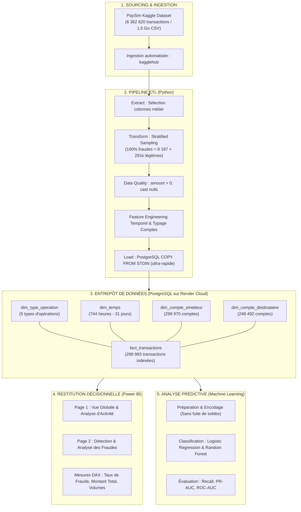

# 🗺️ Schéma d'Architecture - Pipeline PaySim

Ce document décrit l'architecture complète du pipeline de données, de la source brute jusqu'aux usages décisionnels et prédictifs.

---

## 1. Diagramme d'Architecture Détaillé

---

## 2. Choix Technologiques & Justifications

| Composant | Technologie | Justification |
| :--- | :--- | :--- |
| **Langage de Pipeline** | Python 3.15 + pandas + SQLAlchemy | Standard de l'industrie, flexibilité de traitement et intégration native avec PostgreSQL. |
| **Chargement Données** | PostgreSQL `COPY` (psycopg2) | Permet d'insérer 300 000 lignes en moins de 4 minutes, évitant les timeouts HTTP/SSL de Render. |
| **Entrepôt de Données** | PostgreSQL 18 sur Render Cloud | Solution managée cloud gratuite, accessible à distance pour tous les membres de l'équipe et Power BI. |
| **Modélisation** | Schéma en étoile (Kimball) | Réduction drastique des jointures complexes, optimisation des filtres et navigation intuitive dans Power BI. |
| **Outil de Restitution** | Power BI Desktop | Connexion native PostgreSQL, moteur DAX puissant et visualisations interactives professionnelles. |
| **Machine Learning** | scikit-learn / XGBoost | Algorithmes supervisés robustes adaptés aux données tabulaires avec fort déséquilibre de classe. |

---

## 3. Gestion des Contraintes Techniques

1. **Quota de Stockage Render (1 Go)** :
   * *Problème* : Le dataset complet de 6,36 millions de lignes dépasse 1,5 Go sans les index.
   * *Solution* : Échantillonnage stratifié intelligent de 300 000 lignes conservant **100% des fraudes**. Espace final consommé : **112 Mo** seulement.
2. **Durée de vie de l'instance gratuite (30 jours)** :
   * *Problème* : Render supprime les bases gratuites après 30 jours.
   * *Solution* : Automatisation intégrale du DDL et de l'ETL via des scripts Python reproductibles en une commande.
